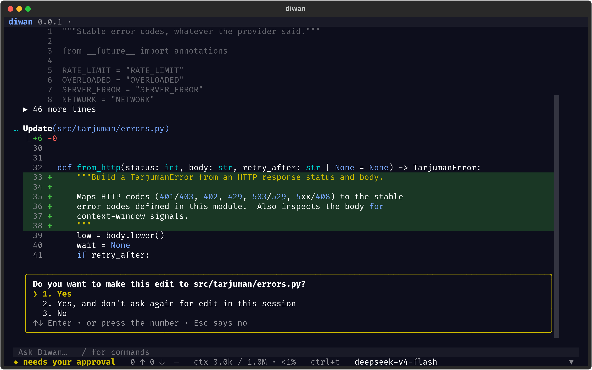
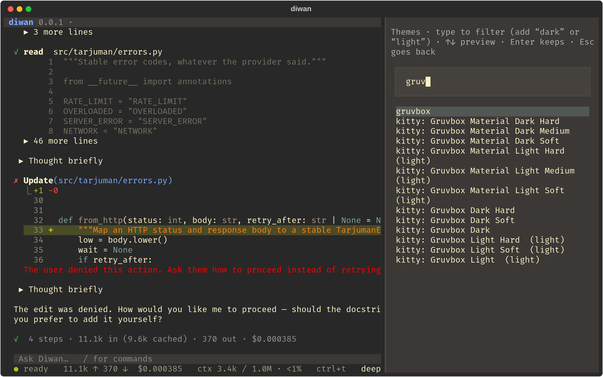
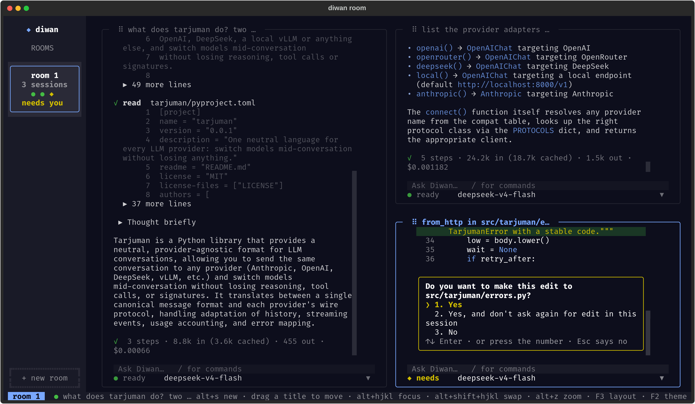

# Diwan

An agent runtime.

**Status:** v0 works: a terminal coding agent with eleven tools (read, grep, glob, write,
edit, bash, note, recall, agent, skill, memory) plus MCP servers' tools loaded on demand,
approvals, retries, long sessions that never run out of context,
and a tree-shaped JSONL log of every session in `~/.diwan/sessions/`.
One conversation can move between models and providers mid-session
(`/model anthropic:claude-sonnet-5-5`, then `/model openrouter:deepseek/deepseek-v4-flash`):
[Tarjuman](https://github.com/Zine-Elabidine/tarjuman) adapts the history, and each model's
own reasoning comes back to it intact.



```
uv tool install -e ~/diwan          # once
echo OPENROUTER_API_KEY=... > ~/.diwan/env && chmod 600 ~/.diwan/env   # or export it
diwan                               # full-screen app in the current folder (--plain for line mode)
diwan -m z-ai/glm-5.3-flash         # any OpenRouter model (default: deepseek/deepseek-v4-flash)
diwan -m anthropic:claude-sonnet-5-5   # [provider:]model; providers: openrouter, anthropic,
                                       #   openai, deepseek, local (keys in ~/.diwan/env)
diwan -p "fix the failing test" -y  # one shot, approve everything
diwan -r                            # resume the last session here
diwan --base-url http://localhost:8000/v1 -m <model>   # local vLLM / llama.cpp
diwan --provider anthropic --base-url <url>   # an Anthropic-compatible gateway
diwan --context 30000               # cap the window (to see compaction early)
diwan --no-summaries                # clear old tool outputs, but never summarize
diwan --sandbox                     # bash in a sandbox, without approvals (Linux, bubblewrap)
diwan --room                        # several sessions tiled on one screen, in rooms
diwan --acp                         # server mode: driven by an editor or another program
```

Inside a session: `/model [provider:]<id>` switches model, `/models [provider] [text]` lists
the catalog with prices, `/rewind [n]`, `/compact [on|off]`, `/notes`, `/skills`, `/memory`, `/mcp`, `/cost`, `/think`, `/new`, `/help`.
Typing while the agent works queues the message: the model gets it after the current step
(a turn about to end answers it first); Esc stops the turn instead.

## The terminal app

**Diffs.** Every `edit` and `write` shows a real diff in the chat, and it stays there: numbered
lines, three lines of context, the changed words marked inside each line, syntax colours from
the current theme. A new file shows as a numbered listing. Reopening a session rebuilds the
diffs from the files.

**Approvals.** The question sits right under the diff it is about, not in a pop-up: `1`/`y`
yes, `2`/`a` yes for this tool for the rest of the session, `3`/`n` no (or arrows and Enter;
Esc says no). In a room, a question doesn't take the focus from the session you are typing in.

**Themes.** The defaults are Modus Vivendi Tinted (dark) and Modus Operandi Tinted (light),
following the desktop's light/dark setting; `ctrl+l` switches. `F2` opens a picker over every
theme: type to filter, arrows preview the theme live on the session, Enter keeps it, Esc goes
back. Besides Diwan's own and Textual's built-ins, it reads kitty's theme collection when kitty
has downloaded it (`~/.cache/kitty/kitty-themes.zip`) and any kitty `.conf` file in
`~/.diwan/themes/`. They are read where they are, not bundled. The choice is saved in
`~/.diwan/ui.json`.



## Sandbox

`--sandbox` (Linux, with bubblewrap) runs `bash` with the whole filesystem read-only except
the project, a fresh `/tmp` and `~/.cache`; the places that hold credentials (`~/.ssh`,
`~/.aws`, `~/.diwan`, ...) are hidden, and everything a command starts ends with it. In
exchange, sandboxed commands run without asking. The network stays on (installing packages
needs it), so a command could still send project files out; `--no-network` cuts it too.

Git hooks and config stay read-only in the sandbox (a command could otherwise plant code
that runs later, outside it, on the user's next git command); commits and branches work.

`write` and `edit` refuse a file the session hasn't read, or one changed since it read it
(by the user, another session, a command): the agent reads it again instead of overwriting
someone else's edit from an old copy.

## Rooms

`diwan --room` puts several sessions on one screen, tiled like a tiling window manager. A new
session splits the focused one along its longer side. Drag the bar between two tiles to
resize them; drag a tile by its title onto another tile's edge to dock it there, or onto its
centre to swap the two. Each tile is titled by its first message.

Rooms are listed as cards in a sidebar: the number of sessions, one dot per session showing
its state, and "needs you" when one waits for an approval. Sessions keep working in rooms you
are not looking at. All sessions work in the same folder, each with its own log, model and
approvals; each tile has a model picker (the current model, those listed in
`~/.diwan/models`, one `provider:model` per line, and each provider's default).

Keys: `alt+s` new session, `alt+q` close it, `alt+h/j/k/l` move between sessions,
`alt+shift+h/j/k/l` swap with a neighbour, `alt+z` zoom one, `F3` switch the layout between
manual and focus (the focused session grows), `alt+n` new room, `alt+r` / `alt+e` next /
previous room (or click its card), `alt+w` hide the sidebar, `esc` stop the focused session.



## Server mode

`diwan --acp` speaks the [Agent Client Protocol](https://agentclientprotocol.com) (v1) on
stdin/stdout: an editor that supports ACP (Zed, JetBrains, Neovim) or any program can start
sessions, send prompts, stream the answer and tool calls back, and answer approvals. One
process holds several sessions, all in the folder it was started in, and can load earlier
ones. MCP servers come from `~/.diwan/mcp.json`; memory is off. A Diwan method,
`_diwan/message`, gives a session a message at any time: during a turn the model gets it at
its next request; an idle session wakes up and starts a turn (the War Room will use it for
messages between sessions). To try it from the terminal:

```
uv run python scripts/acp_client.py "list the python files here"
```

## Long sessions

The log is never edited. Every request is rebuilt from it: the *view* is what the model is
sent, and the log keeps what it no longer sees. Keeping the context small is three steps,
cheapest first:

| when | what | cost |
|---|---|---|
| context at 50% | **clear** old tool outputs (the newest stay word for word); a `mask` event records the replacement text | free |
| still at 75% (or 200k tokens) | **summarize** the oldest messages into a handoff note; a `summary` event records where it cut | one request |
| any time | **recall** searches the full log, cleared outputs and summarized messages included | free |

A summary is the model's note (goal, decisions, rejected approaches, next steps...) plus
what code copies from the log word for word: the user's messages, the model's notes, and the
files it changed. The cut never separates a tool call from its result, and never takes the
model's latest message. The next summary updates the note; the copied part is rebuilt.

The note is written *in place*, as Codex and Claude Code do: the conversation is sent again
exactly as the model last saw it, with one request at the end. The provider's prompt cache
covers almost all of it and nothing is shortened. If that request fails, a plain-text
transcript is sent instead, long tool outputs sharing the room. On a 31k-token DeepSeek session
both ways answered the same follow-up questions about as well; in place, 27.4k of the 27.5k
input tokens came from the cache (on Claude Haiku, 5.8k of 6.1k). `/compact` summarizes all it
may, keeping only the model's latest message onward; the automatic summary cuts just enough.

Summaries leave details out, so the model is told to re-read or use `recall` for exact values
rather than answer from memory. In an early test without `recall`, DeepSeek invented the
retryable error codes after a summary; with it, it found them in the log.

Background reading and the decision: [docs/research-context.md](docs/research-context.md).

## MCP servers

Tools from other programs, through a small client of Diwan's own (JSON-RPC over a child
process's stdin/stdout, or streamable HTTP). List servers in `~/.diwan/mcp.json`, in the
format other agents use:

```json
{"mcpServers": {
  "time": {"command": "uvx", "args": ["mcp-server-time"]},
  "docs": {"url": "https://example.com/mcp", "headers": {"Authorization": "Bearer ..."}}
}}
```

Their tools appear as `mcp__<server>__<tool>`, loaded on demand: the prompt lists only the
servers (with their tool counts), and the model loads the tools it needs with `tool_search`
(keywords, or `select:<name>`), so fifty tools cost nothing until one is used. Every call asks
for approval (server hints
aren't trusted), and Esc cancels a running call. A server that fails to start is reported and
the session goes on; `/mcp` lists servers and tools. Only this user-level file is read: a
project's file would let any cloned repository start programs.

## Skills

A skill is a folder with a `SKILL.md` whose front matter has a `name` and a `description`,
the format Claude Code uses, so existing skills work as they are. Diwan looks in
`.diwan/skills` and `.claude/skills`, in the project and then the home folder. Only the names
and descriptions go into the prompt; when a task matches, the model loads the skill with the
`skill` tool and reads the files it points to (without asking). `/skills` lists them.

## Memory

Each project has a memory folder, `~/.diwan/memory/<project>/`: one file per memory and a
`MEMORY.md` index, which the `memory` tool keeps up to date as it saves. The index goes into
the system prompt at the start (once, so the prompt cache holds); the model reads a memory
file, without approval, when it looks relevant, and saves what a later session needs (who the
user is and how they like to work, the project's goals and decisions, where things are).

With [Telepathy](https://github.com/Zine-Elabidine/telepathy) installed, memory follows you
across machines instead: memory bundles in a private git repo, chosen per project per machine
(`tp use personal my-project`). Diwan runs `tp session start` to load them, saves user and
feedback memories into the personal bundle and the rest into the project's, and runs
`tp session end` at exit to index, commit and push. A project with no bundles on this machine
uses its own folder as above. `--no-memory` turns memory off; `/memory` shows what is loaded.

## Child agents

The `agent` tool hands a task to another agent: the same model, the same approvals, no
agents of its own (one level deep), and read-only tools when asked. It starts *fresh* (only
the task) or as a *fork*: a copy of the conversation sent exactly as the parent last sent it
(same system prompt and tool list, the tools it may not use refused when called), so the
provider's cache covers it; in a DeepSeek run its first request read 2.8k of 3.2k tokens
from the cache. It keeps its own session log; the parent gets back only its
final answer, so a long search costs the parent's context a few lines. Its steps show under
the call, its cost counts in the turn, and Esc stops it with the parent.

Calls the model makes together that need no approval and change nothing (reads, searches,
read-only child agents) run at the same time, up to eight; anything that writes or asks
waits its turn, and results keep the calls' order.

## Layout

```
docs/reading-list.md   what to read in each reference runtime, and in what order
scripts/fetch-refs.sh  clone the reference runtimes into refs/ (gitignored)
scripts/acp_client.py  a small ACP client, to try server mode (the tests use it too)
refs/                  22 open-source runtimes, read-only, never committed
```
